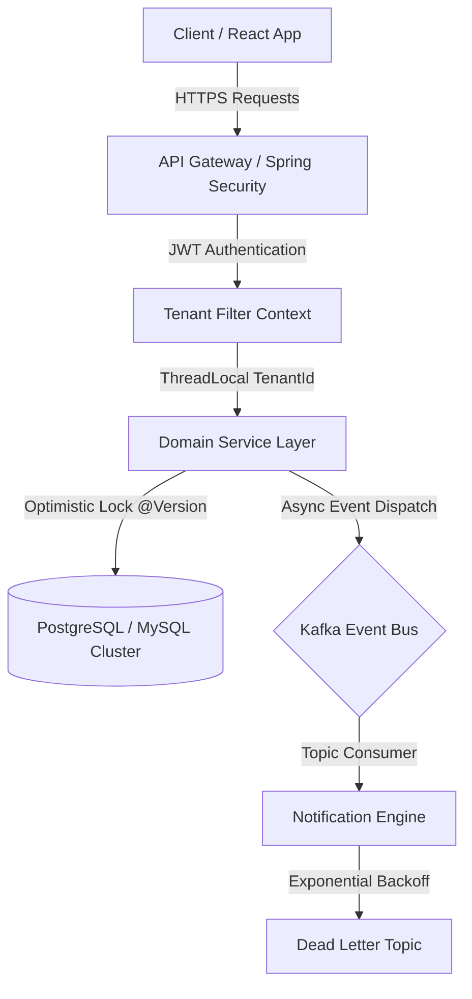
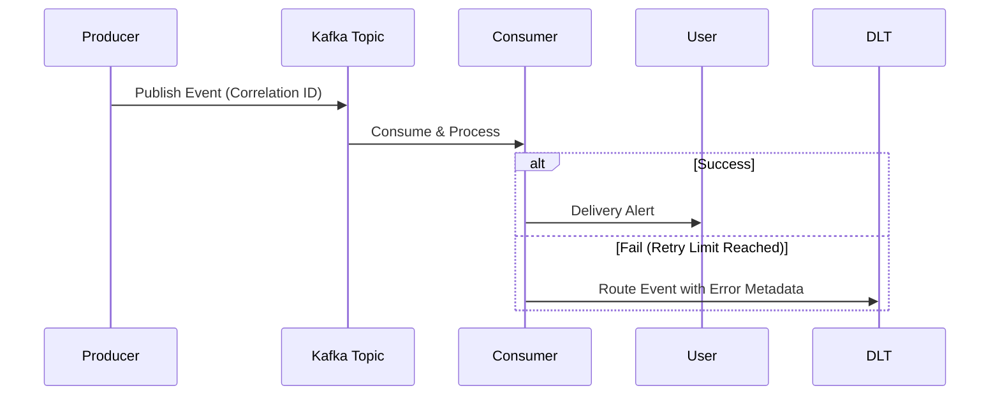

<!-- ===================================================== -->
<!-- 🌌 PREMIUM GITHUB PROFILE README — GOD MODE -->
<!-- ===================================================== -->

<div align="center">

<!-- Custom-designed Bright Branded Header Banner -->


<br/><br/>


<br/>

[](https://github.com/kategauransh)
&nbsp;
[](https://www.linkedin.com/in/gauranshkate26)

<br/>

**ENGINEER &bull; ARCHITECT &bull; DELIVER**  
*Driven by curiosity, continuous learning, and clean systems design.*

</div>

---

## ⚡ Mission Statement
> "Code is a liability. Software architecture is the asset. I engineer distributed, concurrency-safe systems with high transaction integrity, resilient messaging boundaries, and responsive full-stack interfaces."

---

## 🧬 Engineering Philosophy
*   **Production First:** Design for failure, instrument with observability, and automate deployment boundaries.
*   **Clean Architecture:** Strict adherence to the Controller-Service-Repository pattern with clear domain isolation.
*   **Concurrency Safeness:** Lock only when necessary, favor optimistic version checks, and protect shared state.
*   **Continuous Refactoring:** Write code that is easier to read and maintain than it was to write.

---

## 🚀 Technical Focus
<table border="0" width="100%">
  <tr>
    <td width="50%" valign="top">
      <h4>🌐 Backend & Distributed Systems</h4>
      <ul>
        <li><b>Languages:</b> Java, SQL (MySQL, PostgreSQL, H2)</li>
        <li><b>Frameworks:</b> Spring Boot, Spring MVC, Spring Security, Hibernate, Spring Data JPA</li>
        <li><b>Distributed:</b> Apache Kafka Event Streams, Multi-Tenant Database Isolation, Concurrency Checks</li>
      </ul>
    </td>
    <td width="50%" valign="top">
      <h4>🎨 Frontend & Workflows</h4>
      <ul>
        <li><b>Frontend:</b> React JS, JavaScript, HTML5, CSS3, Tailwind CSS</li>
        <li><b>Cloud & Containers:</b> Docker, Docker Compose, AWS S3 Integrations</li>
        <li><b>Tools & APIs:</b> Git, GitHub, Maven, Postman, Swagger/OpenAPI, Razorpay Gateway</li>
      </ul>
    </td>
  </tr>
</table>

---

## 📐 Architecture Mindset


---

## 💼 Flagship Systems

### 💳 High-Throughput Distributed Ledger & Wallet System
*   **Business Problem:** Guaranteeing balance accuracy and transaction audits under high concurrent debit requests.
*   **Architecture & Concurrency:** Designed an immutable financial ledger separating mutable balances from append-only transaction logs. Engineered concurrency safeguards using JPA `@Version` optimistic locking to avoid deadlock states.
*   **Verified Scale:** Validated system correctness with 50 concurrent thread requests across 1,000+ wallets, confirming zero balance drift under high load.

<details>
<summary><b>🔍 System Design Details</b></summary>

*   **Optimistic Lock Strategy:** Rather than locking the database table (pessimistic lock) which hurts read performance, the system updates the version column. If a collision is detected, the transaction retries automatically.
*   **Database Schema:**
```sql
CREATE TABLE wallet (
    id BIGINT PRIMARY KEY,
    balance DECIMAL(19, 4),
    version INT NOT NULL
);
CREATE TABLE ledger_entry (
    id BIGINT PRIMARY KEY,
    wallet_id BIGINT,
    amount DECIMAL(19, 4),
    type VARCHAR(10),
    created_at TIMESTAMP
);
```
</details>

---

### 🏢 Scalable Multi-Tenant B2B SaaS Backend
*   **Business Problem:** Serving multiple organizational tenants on a single shared-database instance with absolute data isolation.
*   **Architecture & Tenant Filtering:** Implemented a tenant discriminator column (`tenant_id`) pattern. Created a custom servlet filter that intercepts incoming requests, extracts the JWT tenant context, and binds it to a `ThreadLocal` execution context.
*   **Data Isolation Guard:** Utilized AOP-driven Hibernate dynamic filters to automatically inject tenant boundaries into every database query, ensuring 100% data separation.

<details>
<summary><b>🔍 System Design Details</b></summary>

```java
// ThreadLocal Tenant Context Container
public class TenantContext {
    private static final ThreadLocal<String> currentTenant = new ThreadLocal<>();
    public static void setCurrentTenant(String tenantId) { currentTenant.set(tenantId); }
    public static String getCurrentTenant() { return currentTenant.get(); }
    public static void clear() { currentTenant.remove(); }
}
```
</details>

---

### ⚡ Real-Time Event-Driven Notification System
*   **Business Problem:** Delivering real-time email and in-app alerts at high volumes without blocking HTTP threads.
*   **Kafka Messaging Architecture:** Built an asynchronous messaging pipeline using Apache Kafka across 5 decoupled topics (Email, Push, SMS, WebSockets, In-App).
*   **Resiliency & Tracking:** Implemented exponential-backoff retry policies with Dead Letter Topic (DLT) fallback routing. Tagged all events with end-to-end Correlation IDs for tracing.

<details>
<summary><b>🔍 System Design Details</b></summary>

*   **Flow Topology:**

</details>

---

## 🎖️ Credentials & Timeline

*   💼 **Advanced Software Engineering Job Simulation** — *Walmart Global Tech* (July 2026)
    *   *Core verifications: Advanced Data Structures, Software Architecture, Relational Database Design, and Data Munging.*
    *   *Verification:* [Walmart Simulation Credential](https://raw.githubusercontent.com/kategauransh/portfolio-v2/main/public/Walmart_Global_Tech_Certificate.pdf)
*   🎓 **Bachelor of Engineering in Information Technology** — *Smt. Kashibai Navale College of Engineering, Pune* (2025)
*   📜 **Java Full Stack Development Training** — *Naresh i Technologies* (2025 - 2026)

---

## 📊 Live System Metrics

<div align="center">

<table border="0">
  <tr>
    <td width="50%" align="center">
      
    </td>
    <td width="50%" align="center">
      
    </td>
  </tr>
</table>

<br/>


</div>

---

<div align="center">

### ✨ Let's Connect

I am always interested in discussing **distributed backend architecture**, **system scalability**, and **full-stack software design**.

<a href="mailto:gauranshkate.it@gmail.com">
  
</a>
&nbsp;
<a href="https://www.linkedin.com/in/gauranshkate26">
  
</a>

<br/><br/>

### 🚀 Open to **Software Engineer / Full Stack Developer** roles  
⭐ *Built for the long game.*

</div>
